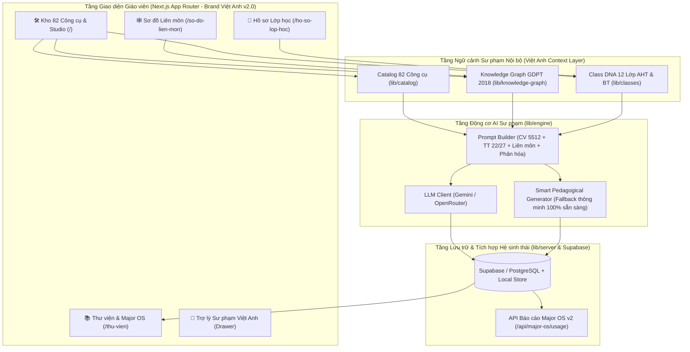

> Ghi chú: phần mô tả kiến trúc trong tài liệu này đã được thay thế bởi [KIEN_TRUC_V2_1.md](KIEN_TRUC_V2_1.md). Giữ lại để tham khảo.

# KIẾN TRÚC KỸ THUẬT & KẾ THỪA KNOWLEDGE GRAPH LIÊN MÔN

Tài liệu này mô tả kiến trúc hệ thống **MagicStudio Việt Anh (`cong-cu-day-hoc`)** và cách kết nối **Cây kiến thức (Knowledge Graph)** từ *AI Personal Tutor* (anh Hùng) với **Hồ sơ Lớp học (Class DNA)** để sinh học liệu tích hợp liên môn.

---

## 1. Sơ đồ Kiến trúc Tổng thể

---

## 2. Cấu trúc Cây Kiến thức Liên môn (`lib/knowledge-graph`)

Để giải quyết bài toán **"tài nguyên tạo ra trên MagicSchool còn riêng lẻ, trong khi công cụ nội bộ hướng đến liên kết các môn để học tích hợp"**, hệ thống tổ chức chương trình GDPT 2018 thành đồ thị gồm 2 thực thể chính:

### 2.1. Nút Kiến thức (`KnowledgeNode`)
Mỗi nút đại diện cho một chủ đề/mạch kiến thức cụ thể của một môn học ở một khối lớp và tuần học:
- `id`: Mã định danh duy nhất (vd: `k7-toan-thong-ke`, `k7-khtn-quang-hop`).
- `grade`, `subject`, `weekRange`: Khối lớp, môn học và khoảng tuần phân phối chương trình.
- `moetRequiredOutcomes`: Danh sách **Yêu cầu cần đạt** nguyên bản theo Chương trình GDPT 2018.
- `coreCompetencies` & `coreQualities`: Năng lực đặc thù và Phẩm chất chủ yếu.
- `vietAnhPracticalHook`: Gợi ý hoạt động **"Vui vẻ và Thực dụng"** gắn với đời sống học sinh Việt Anh.

### 2.2. Cạnh Liên kết Liên môn (`KnowledgeEdge`)
Mỗi cạnh nối 2 nút kiến thức thuộc 2 môn học khác nhau theo 4 kiểu quan hệ sư phạm:
1. `cung_chu_de_tuan` (**Cùng chủ đề tuần**): Hai môn dạy song song trong cùng giai đoạn tuần học, giúp học sinh nhìn một hiện tượng dưới nhiều góc độ.
2. `ung_dung_thuc_te` (**Ứng dụng thực tế**): Dùng công cụ của môn A (vd: *Biểu đồ thống kê Toán 7*) để xử lý dữ liệu thực nghiệm của môn B (vd: *Tốc độ quang hợp KHTN 7* hoặc *Biến đổi khí hậu Địa lý 7*).
3. `tien_quyet` (**Kiến thức tiên quyết**): Kiến thức nền tảng ở môn A hỗ trợ trực tiếp cho bài học ở môn B.
4. `du_an_steam_lien_mon` (**Dự án STEAM liên môn**): Tổ hợp từ 2–3 môn để tổ chức dự án học tập (PBL) hoặc ngày hội trải nghiệm.

---

## 3. Luồng Nạp Ngữ cảnh vào Prompt (`lib/engine/promptBuilder.ts`)

Khi giáo viên bấm **"Sinh Học liệu"** trên bất kỳ công cụ nào trong 82 công cụ, `promptBuilder.ts` tự động hợp nhất **4 lớp thông tin**:

1. **Lớp Chuẩn Bộ GD&ĐT & Trường Việt Anh:** Khung Công văn 5512 (4 hoạt động), chuẩn đánh giá Thông tư 22/2021 hoặc 27/2020, và nguyên tắc *"Vui vẻ và Thực dụng"*.
2. **Lớp Đặc tả Công cụ (Tool Schema):** Các trường đầu vào riêng của công cụ và mẫu cấu trúc đầu ra (`outputSections`).
3. **Lớp Hồ sơ Lớp học (`ClassProfile`):** Sĩ số, tỷ lệ 3 mức độ (*Cơ bản / Chuẩn / Nâng cao*), sở thích của lớp, trình độ tiếng Anh và cách hỗ trợ riêng cho các mã học sinh `VA-2026-NNNNN`.
4. **Lớp Đồ thị Liên môn (`KnowledgeNode` + `KnowledgeEdge`):** Yêu cầu cần đạt của bài học chính + danh sách các môn học liên kết kèm ý tưởng hoạt động chung (`suggestedSharedActivity`).
